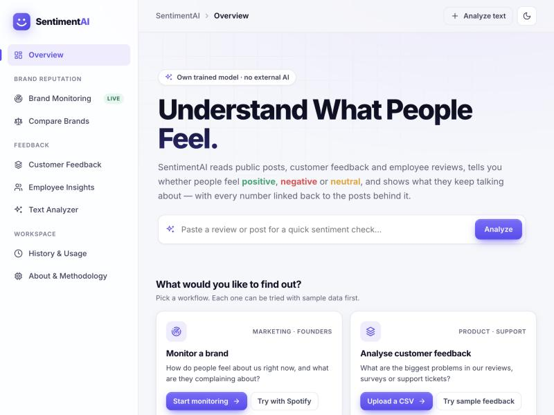
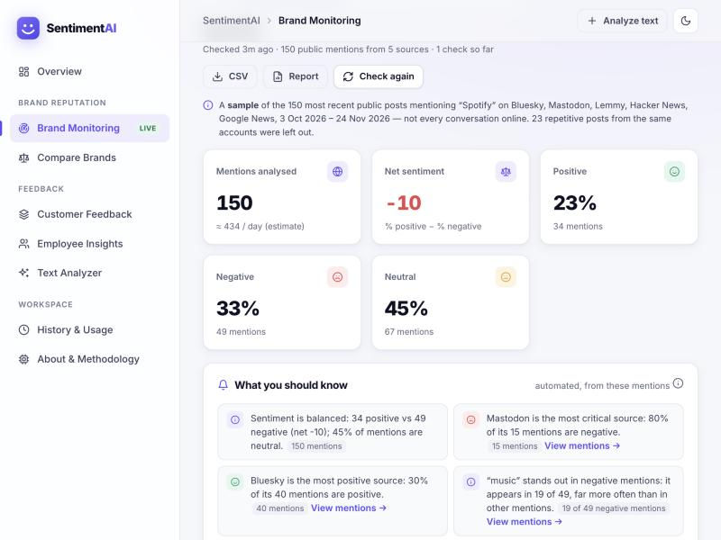
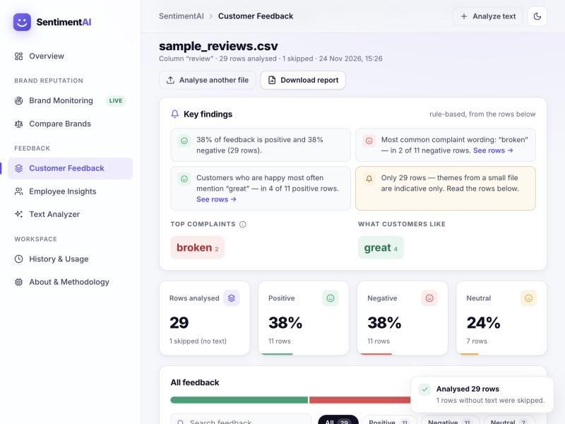
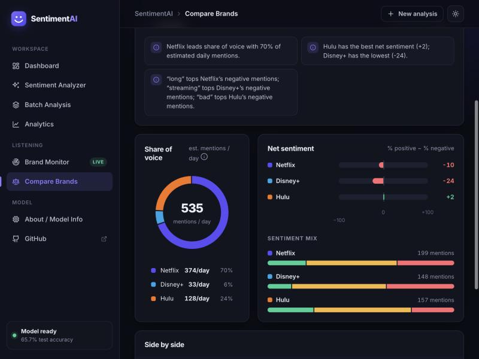
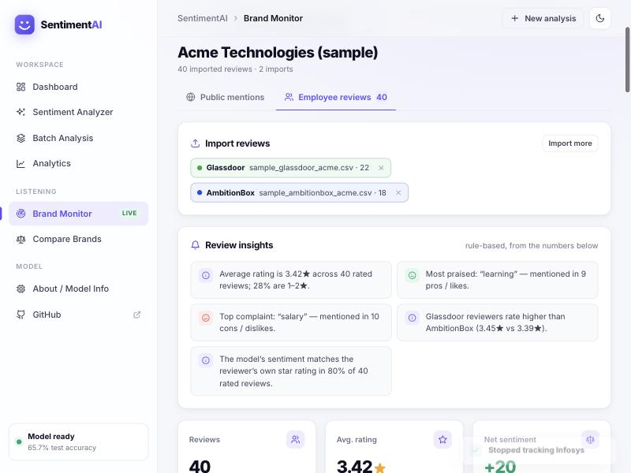
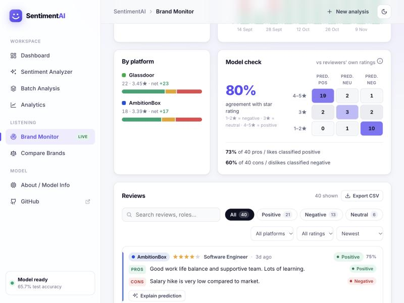
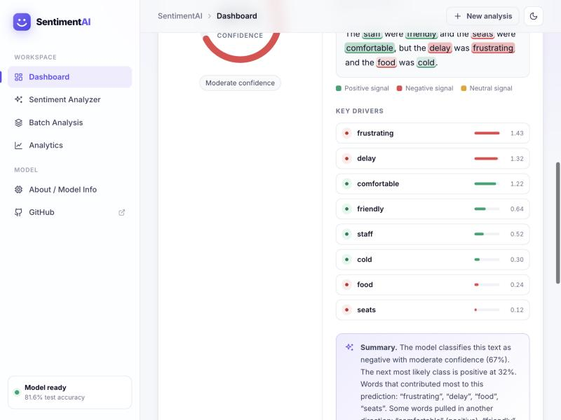
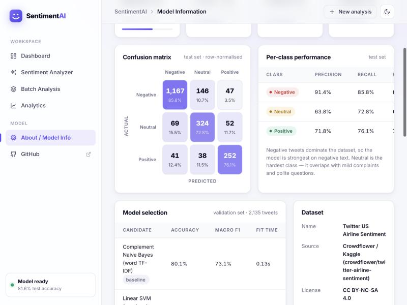
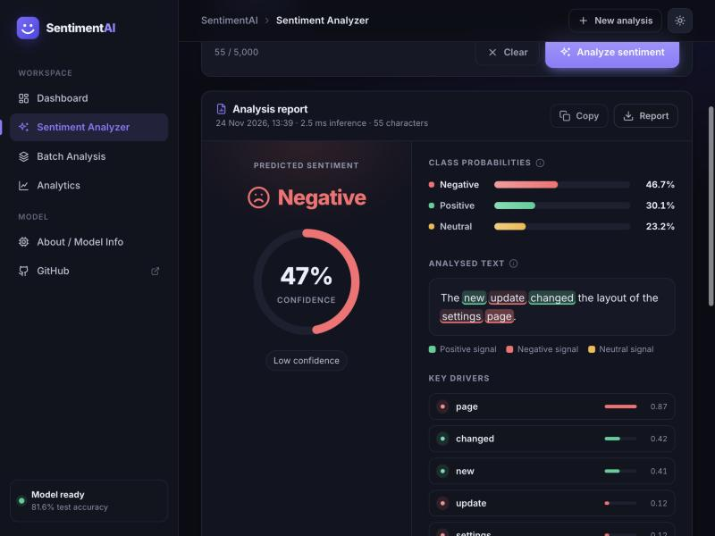

<div align="center">

# SentimentAI

**Understand what people feel.** An AI-powered sentiment analysis and **brand-monitoring** web app.
It classifies text as **positive**, **negative** or **neutral** with calibrated probabilities and
word-level explanations, and it listens to live public conversation about any brand across social
media, forums and news.

`Python` · `FastAPI` · `scikit-learn` · `TF-IDF + Logistic Regression` · `httpx` · `Vanilla JS (no build step)` · `SVG charts`

### 🔗 Live demo: **[sentiment-ai-eight-orcin.vercel.app](https://sentiment-ai-eight-orcin.vercel.app)**



</div>

---

## Highlights

### Built around what people want to find out
The **Overview** starts from questions, not features. It offers four workflows (monitor a brand, analyse customer feedback, compare competitors, understand employee reviews), each with a one-click sample. A quick text check and a "brands at a glance" table round it out: latest net sentiment, change since the last check, and employee rating.

Every workflow leads with plain-English findings. Each finding shows its **evidence**, meaning the sample size behind it, and links to the posts or rows that support it. Every workflow exports a **shareable HTML report** that prints to PDF, with data source, period, sample size, findings, representative quotes, methodology and limitations.

### Customer Feedback (CSV)
- Upload a file and **preview it before analysis**: the detected feedback column (you can change it), sample rows, and how many rows will be analysed or skipped.
- Handles real-world files: UTF-8, UTF-16 and Latin-1; comma, semicolon, tab or pipe delimiters; unquoted commas in one-column files; files over the row limit.
- Results lead with **Key findings**, **Top complaints** and **What customers like**. These are words and phrases over-represented in negative or positive rows. Clicking one shows those rows.

### Brand Monitoring (social listening)
- **Live mentions from 5 sources:** Bluesky, Mastodon, Lemmy, Hacker News and Google News. No API keys are needed, and the sources are fetched in parallel in about 2–5 s.
- **Per-brand dashboard.** It shows the mention count and an estimated mentions per day, a **net sentiment** score from −100 to +100, positive and negative share, and engagement. It also breaks sentiment down by source, plots mention volume over time, and lists the words that stand out in positive vs negative mentions.
- A clear sample-coverage note (sources, date range, posts excluded as spam), and **small-sample protection**: under 15 mentions the app shows a caution instead of confident-sounding insights.
- **Alerts and insights.** These are transparent, rule-based findings computed from the data on screen: a negative spike in the last 24 h, the most critical source, a recurring complaint word, and a high-engagement negative post worth reviewing. You also get **change alerts between checks**, e.g. "negative share jumped from 20% to 41% since your last check".
- **Mention feed.** You can filter by sentiment and source, search, and sort by newest, most engagement, most negative or most positive. Every mention links to the original. **Explain prediction** opens it in the Analyzer with word highlights, and you can export everything as CSV.
- **Spam control.** Each account is capped at 3 mentions per source, so bots and auto-posters can't skew the numbers. The UI shows how many posts were filtered.
- **Compare Brands.** Put up to three competitors side by side: **share of voice**, net sentiment, sentiment mix, and the word that drives each brand's complaints.
- Tracked brands and their run history persist in the browser.

### Employee Insights (Glassdoor · AmbitionBox · any CSV)
- **Import reviews** for a brand from a CSV file or pasted text. Columns are detected automatically: Pros/Likes, Cons/Dislikes, Review, Title, Rating (`4`, `4.5`, `8/10`, `★★★★`), Date, Job title/Designation, Location.
- **What people like vs dislike.** Pros and cons are analysed separately, and recurring themes are extracted as words and two-word phrases ("work-life balance", "salary hikes", "slow promotions").
- **Rating analysis:** average rating, the 1–5★ distribution, a per-platform comparison, and reviews per week or month.
- **A model check against real labels.** Each reviewer's own star rating is compared with the model's sentiment (1–2★ = negative, 3★ = neutral, 4–5★ = positive). The app shows the agreement rate and a small confusion grid, and flags reviews where the two disagree.
- Imports are de-duplicated and can be removed one at a time. A review feed has filters (sentiment, platform, rating, search), CSV export and **Explain prediction**.
- **No scraping.** Glassdoor and AmbitionBox forbid automated collection in their terms, and neither offers a public API. Glassdoor also blocks bots (HTTP 403). So reviews are **imported by the user**, never fetched by the app. Two synthetic sample files for a fictional company are bundled for demos (**Load sample employee reviews**).

### Core sentiment tools
- **A real trained model.** TF-IDF (word 1–2-grams + character 2–5-grams) → multinomial logistic regression, trained on **74k labelled tweets from two datasets**. Nothing is hard-coded or randomised.
- **Honest evaluation.** The app reports separate held-out test scores for each dataset. Model selection happens on a validation set, and the app reads every metric from `models/metrics.json`.
- **Explainable predictions.** Each word is removed in turn and the text is re-scored (occlusion analysis). Words that shift the log-odds get highlighted.
- **Analysis report** with a confidence gauge, class probabilities, key drivers and a plain-English summary. You can copy it or download it as Markdown.
- **Batch CSV analysis** with automatic text-column detection, search, filters and CSV export.
- **Analytics dashboard** with distribution, trend, confidence charts and history (kept in `localStorage`).
- **Text Analyzer** warns when text probably isn't English, or is too short to judge, and explains that confidence is an estimated probability, not a guarantee.
- **Product polish:** light and dark themes; responsive from 320 px to 1920 px; toasts, tooltips, skeleton loaders, empty states with next steps, retry buttons on failures, and a warning before you close a tab mid-analysis.
- **Accessibility:** WCAG-AA text contrast, keyboard access to every control (including chips and table rows), focus moves to the page heading on navigation, ARIA labels and reduced-motion support.
- **Privacy:** no accounts or database. History and imports stay in your browser, there's a one-click "clear all local data", and the server processes text in memory only.

## Quick start

Requirements: **Python 3.10+** (developed and tested on 3.12; if [uv](https://docs.astral.sh/uv/) is installed, `run.sh` uses it to create a 3.12 environment automatically). Brand monitoring needs an internet connection.

```bash
./run.sh
```

Your browser opens the app automatically. The terminal prints the address: normally **http://localhost:8000**, or the next free port if 8000 is taken.

`run.sh` creates `.venv`, installs dependencies, downloads the datasets and trains the model **only if** `models/` is empty, and then starts the server. A trained model is already committed, so the first launch takes seconds.

<details>
<summary>Manual setup (Windows / without run.sh)</summary>

```bash
python -m venv .venv
# macOS/Linux: source .venv/bin/activate     Windows: .venv\Scripts\activate
pip install -r requirements.txt

python scripts/download_data.py   # → data/raw/Tweets.csv + data/raw/tweeteval_*.csv
python scripts/train.py           # → models/sentiment_model.joblib + models/metrics.json (~1 min)
uvicorn sentiment.api:app --port 8000
```
</details>

## Deployment (Vercel)

The live demo runs on Vercel as a single Python function. Vercel detects FastAPI through `app.py`, and every push to `main` redeploys automatically.

- **The model runs inside the function.** There is no external AI API, API key or per-request cost. The 8 MB model loads once per instance in about 1 s, and a prediction takes about 5 ms.
- **Dependencies are pinned** in `requirements.txt` (scikit-learn 1.9.1 matches the saved model). Training-only packages (`pyarrow`, `pytest`) live in `requirements-dev.txt`, so they aren't installed on the server.
- `.python-version` selects Python 3.12, and `vercel.json` keeps tests, docs, data and scripts out of the function.
- **Uploads are capped at 4 MB** because Vercel rejects request bodies over 4.5 MB.
- Peak memory under the heaviest requests is about 440 MB, well within a Vercel function's default memory.
- All five Brand Monitor sources work from Vercel's servers.

To deploy your own copy, import the repository at [vercel.com/new](https://vercel.com/new) and keep the default settings. No environment variables are needed.

## Live data sources

| Source | What is fetched | Endpoint |
|---|---|---|
| **Bluesky** | Latest English posts matching the query | `api.bsky.app` public search |
| **Mastodon** | Latest posts with the brand hashtag | `mastodon.social` public tag timeline |
| **Lemmy** | Newest posts and comments (Reddit-style forums) | `lemmy.world` public search |
| **Hacker News** | Newest stories and comments | Algolia HN Search API |
| **Google News** | Recent headlines | Google News RSS |

Only items that literally contain the search term are kept. Responses are cached in memory for 10 minutes to respect rate limits. If a source is down or rate-limited, the others still work, and the UI shows which source failed and why.

**Not included, and why:** Glassdoor and AmbitionBox prohibit scraping and have no public API, so they're supported through **import** instead (see above). X/Twitter requires a paid API plan. Reddit blocks unauthenticated API access (it could be added with an OAuth app and credentials). Apple's public App Store review feed no longer returns reviews.

## Training data

| Dataset | Rows | Domain | Split |
|---|---|---|---|
| [Twitter US Airline Sentiment](https://www.kaggle.com/datasets/crowdflower/twitter-airline-sentiment) (Crowdflower, CC BY-NC-SA 4.0) | 14,640 | Customer-service tweets about six US airlines | Stratified 70/15/15, seed 42 |
| [TweetEval — sentiment](https://huggingface.co/datasets/cardiffnlp/tweet_eval) (SemEval-2017, Barbieri et al. 2020) | 59,899 | General-topic tweets: brands, products, people, events | Official train / val / test |

`python scripts/download_data.py` fetches both from Hugging Face, so you don't need a Kaggle account. The airline set alone gave the model a strong customer-service bias: general text came out far too negative, e.g. Netflix scored −52. Adding TweetEval fixed that, so brand results are now realistic (Netflix about −10).

If the model files are missing, the app **does not** fall back to fake predictions. The API returns `503 model_not_ready`, and the UI shows a setup banner.

## Model performance

These results are on held-out test sets the model never saw during training or model selection. They're shown on the **About / Model Info** page, which has a test-set switcher.

| Test set | Tweets | Accuracy | Macro precision | Macro recall | Macro F1 |
|---|---|---|---|---|---|
| Airline (customer service) | 2,136 | **82.2%** | 77.7% | 74.8% | 75.9% |
| TweetEval (general topics) | 12,277 | **62.9%** | 62.9% | 62.9% | 62.5% |
| Combined | 14,413 | 65.7% | 65.6% | 65.3% | 65.2% |

TweetEval is a deliberately hard benchmark: macro recall is its official metric, and classical TF-IDF baselines typically score in the low 60s. Fine-tuned transformers reach about 72–73.

Per-class results on the airline test set:

| Class | Precision | Recall | F1 | Support |
|---|---|---|---|---|
| Negative | 86.3% | 92.0% | 89.1% | 1,360 |
| Neutral | 73.5% | 57.3% | 64.4% | 445 |
| Positive | 73.2% | 75.2% | 74.2% | 331 |

> Re-training rewrites `models/metrics.json`, and the UI always shows whatever that file contains. The numbers above are from the committed model (seed 42).

### Why this model?

| Candidate (combined validation set) | Accuracy | Macro F1 |
|---|---|---|
| Complement Naive Bayes (word TF-IDF) | 69.7% | 67.6% |
| Linear SVM (word + char TF-IDF) | 75.3% | 74.4% |
| Logistic Regression C=2 (word TF-IDF) | 74.3% | 73.3% |
| **Logistic Regression C=1 (word + char TF-IDF)** ✅ | **75.1%** | **74.1%** |
| Logistic Regression C=2 (word + char TF-IDF) | 75.1% | 74.1% |

The selection metric is **macro F1**. Only logistic regression is eligible for deployment: it produces genuine class probabilities, which the UI displays and which the explanations rely on. The SVM is reported as a baseline.

### Limitations

- A bag-of-words model can't really detect sarcasm ("great, another delay") or long-range negation.
- Long technical comments (Hacker News, Lemmy) and news headlines are further from the tweet training data. Treat each prediction as an estimate and rely on aggregates.
- Mentions per day and share of voice are **estimates**, based on the time span the fetched mentions cover. They are not complete counts.
- The model handles English only.
- A prediction describes the text, not the author's true intent.

## Screenshots

| Brand Monitoring | Customer Feedback |
|---|---|
|  |  |
| **Compare Brands** | **Employee Insights** |
|  |  |
| **Model check vs star ratings** | **Text Analyzer report** |
|  |  |
| **About & Methodology** | **Dark mode** |
|  |  |

## Project structure

```
├── run.sh                    # one-command setup + launch (auto-picks a free port, opens browser)
├── requirements.txt
├── scripts/
│   ├── download_data.py      # fetch both training datasets
│   └── train.py              # clean → split → compare models → evaluate per dataset → save
├── sentiment/
│   ├── preprocess.py         # text normalisation (shared by training & inference)
│   ├── model.py              # loading, prediction, occlusion explanations, summaries
│   ├── sources.py            # live mention fetchers (Bluesky, Mastodon, Lemmy, HN, News) + cache
│   ├── monitor.py            # brand analysis: scoring, spam cap, keywords, rates, insights
│   ├── reviews.py            # review import: CSV/paste parsing, pros/cons themes, rating agreement
│   ├── tabular.py            # robust CSV reading (encodings, delimiters, malformed rows)
│   ├── themes.py             # distinctive words/phrases for complaints and praise
│   └── api.py                # FastAPI: /api/* + serves the web UI
├── models/
│   ├── sentiment_model.joblib
│   └── metrics.json          # every metric the UI displays
├── web/                      # static frontend, no build step
│   ├── index.html
│   ├── css/styles.css
│   ├── js/                   # app (router), analyzer, batch, analytics, monitor, reviews, compare, brands, charts …
│   └── samples/              # sample_reviews.csv + synthetic Glassdoor / AmbitionBox-format review files
├── tests/                    # pytest: API, model, batch, monitor (network mocked)
└── data/raw/                 # datasets (git-ignored)
```

## API

| Method | Endpoint | Description |
|---|---|---|
| `GET` | `/api/health` | `{status, model_ready}` |
| `GET` | `/api/model` | Contents of `metrics.json` |
| `POST` | `/api/analyze` | `{"text": "..."}` returns label, confidence, probabilities, keywords, summary |
| `POST` | `/api/batch/preview` | multipart `file` returns every column with text counts and samples, plus the detected feedback column |
| `POST` | `/api/batch` | multipart `file` (CSV ≤ 4 MB, ≤ 5,000 rows) plus optional `column`; returns per-row predictions, a summary and complaint/praise themes |
| `GET` | `/api/sources` | Available live sources |
| `POST` | `/api/monitor` | `{"query": "Spotify", "sources": [...], "limit": 50}` returns scored mentions, summary and insights |
| `POST` | `/api/reviews/parse` | multipart `platform` (`glassdoor` / `ambitionbox` / `other`) plus a `file` (CSV) or `text` (pasted); returns normalised reviews and the detected column mapping |
| `POST` | `/api/reviews/analyze` | `{"reviews": [...]}` (≤ 3,000) returns per-review sentiment (overall, pros, cons), themes, rating distribution and model-vs-rating agreement |

Interactive docs are at **/docs** on the running server.

```bash
curl -s localhost:8000/api/monitor -H 'Content-Type: application/json' \
  -d '{"query":"Spotify","limit":25}' | python -m json.tool | head -40
```

## How it works

**A single prediction:**
1. **Normalise.** Lower-case the text, replace URLs, drop @mentions, expand contractions and map emoticons to tokens.
2. **Vectorise.** Combine word 1–2-gram and character 2–5-gram TF-IDF into 220k sparse features.
3. **Classify.** Multinomial logistic regression with a softmax produces probabilities that sum to 1.
4. **Explain.** Remove each word, re-score, and measure the change in log-odds.

**A brand check:**
1. Fetch from every selected source in parallel, keep only items containing the term, and de-duplicate.
2. Cap each account at 3 mentions per source to filter spam.
3. Score every mention with the model.
4. Aggregate: counts, net score, per-source breakdown, mention rate, and over-represented words. For each word, the app compares the share of positive (or negative) mentions containing it against all other mentions.
5. Turn the numbers into rule-based insights, and compare the result with the previous check for change alerts.

## Testing

```bash
.venv/bin/python -m pytest -q
```

74 tests cover preprocessing, predictions, explanations, input validation, batch CSV handling, the monitor pipeline (spam cap, net-score maths, keyword extraction, failures and 502s), the source parsers, review import (column detection for both formats, pasted text, rating parsing, agreement maths, themes), CSV robustness (encodings, delimiters, malformed rows), feedback previews and themes, non-English warnings, small-sample handling, link sanitisation, and error responses that never leak stack traces. Network calls are mocked, so the suite runs offline.

## Configuration

- **Port:** run `PORT=9000 ./run.sh`. A busy port is skipped automatically.
- **No auto-open:** run `NO_BROWSER=1 ./run.sh`.

## License

The code is [MIT](LICENSE). The Airline dataset is CC BY-NC-SA 4.0 and TweetEval is for research use, so the trained model is for non-commercial use. Fetched mentions and imported reviews belong to their authors and are processed in memory and in your browser only. The bundled Glassdoor/AmbitionBox-format sample files are synthetic and describe a fictional company.
